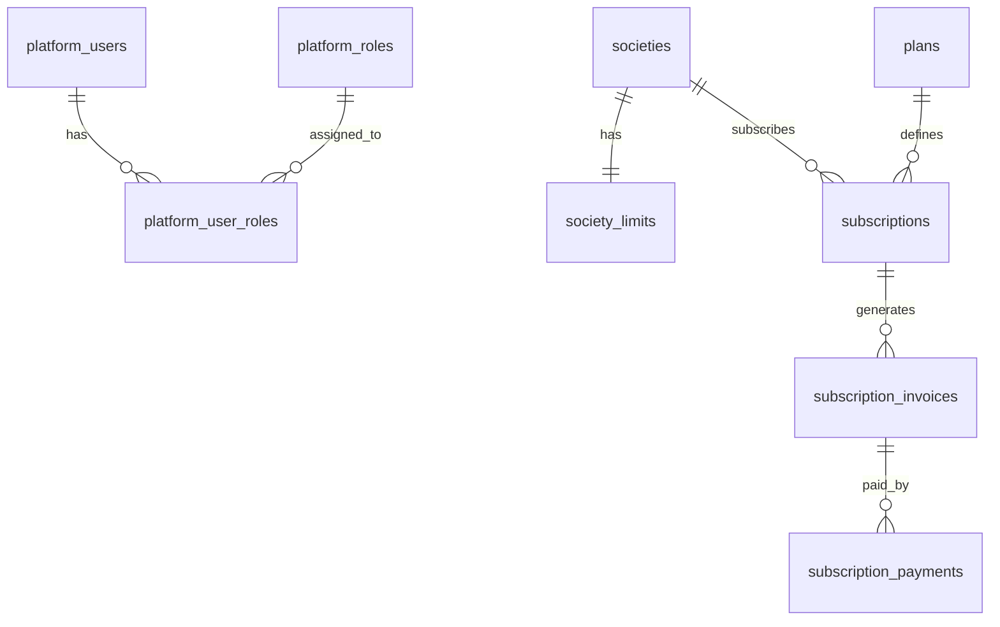
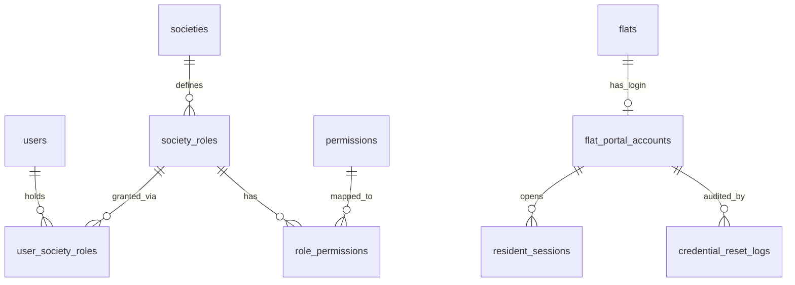
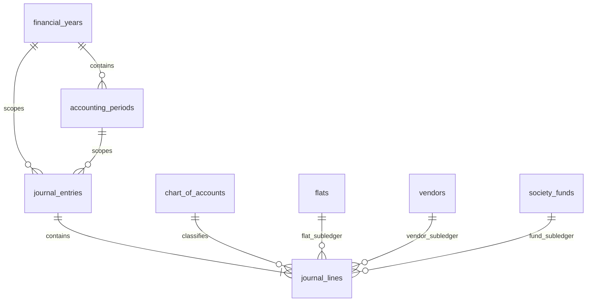

# SocietyBook Database Schema Reference

This document describes the PostgreSQL / Drizzle ORM schema for **SocietyBook**, hosted on **Neon Lakebase Postgres**.

All schema definitions live under [`db/schema/`](../db/schema/index.ts).

---

## Multi-Tenant Isolation Rules

1. **Tenant Key (`society_id`)**: Every society-owned table includes a non-null `society_id` referencing `societies(id)`.
2. **Composite Unique Constraints**: Parent tables define `UNIQUE (society_id, id)`.
3. **Composite Foreign Keys**: Child tables reference `(society_id, parent_id) -> parent(society_id, id)` so PostgreSQL physically rejects cross-society references (e.g., a Society A payment or journal line cannot reference a Society B flat, vendor, or fund).
4. **Tenant-First Indexes**: Indexes on society-owned tables start with `society_id`.
5. **Financial Precision**: All monetary amounts use `NUMERIC(14, 2)` (never floating point).

---

## 1. Platform Module (`db/schema/platform.ts`)

SaaS operator portal, societies, subscription plans, and platform billing (completely separate from society maintenance payments).

| Table | Purpose | Key Columns & Constraints |
| --- | --- | --- |
| `platform_users` | SaaS Super Admin / operator accounts | `id`, `email` (unique), `password_hash`, `status`, `credential_version` |
| `platform_roles` | Platform-level roles | `id`, `code` (unique), `name` |
| `platform_user_roles` | Maps `platform_users` to `platform_roles` | `platform_user_id`, `platform_role_id` (unique pair) |
| `plans` | SaaS subscription tiers | `id`, `code` (unique), `billing_cycle`, `price_inr` (>= 0), `max_flats_default`, `max_users_default` |
| `societies` | Tenant societies | `id`, `code` (unique, e.g. `GREENVALLEY`), `name`, `registration_number`, `status` |
| `society_limits` | Enforced flat & user quotas per society | `society_id` (unique), `max_flats` (> 0), `max_users` (> 0) |
| `subscriptions` | Active/past society subscriptions | `society_id`, `plan_id`, `status`, `starts_at`, `expires_at` |
| `subscription_invoices` | SaaS billing invoices | `society_id`, `subscription_id`, `invoice_number` (unique), `total_inr`, `status` |
| `subscription_payments` | SaaS gateway payment records | `society_id`, `invoice_id`, `idempotency_key` (unique), `amount_inr` (> 0) |
| `subscription_webhooks` | Verified payment gateway webhooks | `gateway_name`, `event_id` (unique pair), `signature_verified` |
| `platform_audit_logs` | SaaS operator audit trail | `platform_user_id`, `society_id`, `action`, `entity_type`, `entity_id` |

---

## 2. Authentication & Authorization Module (`db/schema/auth.ts`)

Society Admin/Staff dynamic RBAC and Resident Flat Portal accounts.

| Table | Purpose | Key Columns & Constraints |
| --- | --- | --- |
| `users` | Society Admin & Staff identities | `id`, `email` (unique), `password_hash`, `status`, `credential_version` |
| `permissions` | Global permission catalog | `id`, `code` (unique, e.g. `accounting.view`), `module` |
| `society_roles` | Per-society custom roles | `society_id`, `name` (unique per society), `is_system_admin` |
| `role_permissions` | Permissions assigned to a `society_role` | `society_id`, `role_id`, `permission_id` |
| `user_society_roles` | Scopes a user's role to a specific society | `user_id`, `society_id`, `role_id` (unique triple) |
| `flat_portal_accounts` | One portal login per flat (e.g. `GREENVALLEY-A101`) | `society_id`, `flat_id` (unique per society), `username` (globally unique), `password_hash`, `credential_version` |
| `resident_sessions` | Hashed refresh token sessions for residents | `society_id`, `flat_portal_account_id`, `refresh_token_hash`, `revoked_at` |
| `credential_reset_logs` | Audit log for resident credential provisioning/resets | `society_id`, `flat_portal_account_id`, `reset_by_user_id`, `action` |
| `login_attempts` | Rate-limiting / lockout tracking | `account_type`, `identifier`, `succeeded`, `attempted_at` |

---

## 3. Society & Residents Module (`db/schema/society.ts`)

Physical structure, resident profiles, historical occupancies, and society-owned payment channels.

| Table | Purpose | Key Columns & Constraints |
| --- | --- | --- |
| `society_settings` | Financial year, interest, and prefix config | `society_id` (unique), `financial_year_start_month` (default `4`), `overdue_interest_rate_annual` |
| `buildings` | Society buildings | `society_id`, `code` (unique per society), `name` |
| `wings` | Wings within a building | `society_id`, `building_id`, `code` (composite FK to `buildings`) |
| `flats` | Units/flats | `society_id`, `building_id`, `wing_id`, `flat_number`, `area_sq_ft`, `status` |
| `residents` | Owner/tenant profiles (separate from logins) | `society_id`, `full_name`, `email`, `phone`, `is_active` |
| `flat_occupancies` | Historical & multi-owner occupancy records | `society_id`, `flat_id`, `resident_id`, `occupancy_type`, `start_date`, `end_date` |
| `society_bank_accounts` | Society's own bank accounts | `society_id`, `bank_name`, `account_number_masked`, `ifsc_code` |
| `society_payment_methods` | Society's own UPI ID / QR / bank transfer details | `society_id`, `method_type`, `upi_id`, `qr_image_object_key`, `bank_account_id` |

---

## 4. Accounting Engine Module (`db/schema/accounting.ts`)

Double-entry general ledger with **subledger dimensions** (`flat_id`, `vendor_id`, `fund_id`) on `journal_lines`.

| Table | Purpose | Key Columns & Constraints |
| --- | --- | --- |
| `financial_years` | Fiscal years (default Apr 1 – Mar 31) | `society_id`, `label` (unique per society), `start_date < end_date`, `status` |
| `accounting_periods` | Monthly periods with lock flag | `society_id`, `financial_year_id`, `period_number`, `is_locked` |
| `chart_of_accounts` | Society-specific CoA with control flags | `society_id`, `code`, `account_type`, `requires_flat`, `requires_vendor`, `requires_fund` |
| `society_funds` | Sinking, Repairs, Reserve, and custom funds | `society_id`, `code`, `fund_type`, `control_account_id` |
| `vendors` | Suppliers and service providers | `society_id`, `code`, `name`, `gstin`, `pan` |
| `journal_entries` | Immutable posted journal headers | `society_id`, `financial_year_id`, `voucher_series`, `voucher_number`, `idempotency_key` (unique per society) |
| `journal_lines` | Balanced debit/credit lines + dimensions | `debit >= 0`, `credit >= 0`, never both > 0, composite FKs for `flat_id`, `vendor_id`, `fund_id` |
| `fund_transactions` | Fund contributions, utilizations, transfers | `society_id`, `fund_id`, `transaction_type`, `amount > 0`, `journal_entry_id` |
| `bills` | Vendor expense bills | `society_id`, `vendor_id`, `expense_account_id`, `bill_number`, `total_amount > 0`, `status` |
| `bank_statement_imports` | Imported CSV/Excel bank statements | `society_id`, `bank_account_id`, `statement_from_date`, `statement_to_date` |
| `bank_statement_transactions` | Individual statement rows for matching | `society_id`, `import_id`, `match_status`, `matched_journal_entry_id` |
| `bank_reconciliations` | Book vs statement reconciliation records | `society_id`, `bank_account_id`, `statement_closing_balance`, `book_closing_balance`, `status` |
| `year_closings` | Year-end closing & carry-forward records | `society_id`, `financial_year_id` (unique), `closing_journal_entry_id`, `opening_balance_journal_entry_id` |

---

## 5. Maintenance & Society Payments Module (`db/schema/maintenance.ts`)

Monthly maintenance billing and resident-to-society payment verification workflow.

| Table | Purpose | Key Columns & Constraints |
| --- | --- | --- |
| `maintenance_heads` | Configurable charge heads | `society_id`, `code`, `calculation_method`, `default_rate`, `income_account_id` |
| `maintenance_demands` | Monthly flat-wise maintenance bills | `society_id`, `flat_id`, `demand_number`, `total_amount`, `status`, `journal_entry_id` |
| `maintenance_demand_items` | Line items per demand | `society_id`, `demand_id`, `head_id`, `amount >= 0` |
| `payments` | Resident/staff payment submissions | `society_id`, `flat_id`, `payment_mode`, `amount > 0`, `utr_reference`, `status` (`pending_verification` by default) |
| `payment_verifications` | Staff approval/rejection records | `society_id`, `payment_id`, `decision`, `verified_by_user_id` |
| `payment_allocations` | Allocates verified payment to demands | `society_id`, `payment_id`, `demand_id`, `allocated_amount > 0` |
| `receipts` | Sequential receipts issued after approval | `society_id`, `financial_year_id`, `payment_id` (unique), `receipt_series`, `receipt_number` |
| `payment_adjustments` | Credit/debit adjustments | `society_id`, `flat_id`, `adjustment_type`, `amount > 0`, `journal_entry_id` |

---

## 6. Operations & Audit Modules (`db/schema/operations.ts`, `db/schema/audit.ts`)

| Table | Module | Purpose |
| --- | --- | --- |
| `complaints` | Operations | Society/flat complaints, priority, status, assignment |
| `complaint_comments` | Operations | Internal and public comments on complaints |
| `attachments` | Operations | Object Storage (`assets` bucket) references for bills, proofs, complaints, notices |
| `notices` | Operations | Society-wide notices and announcements |
| `audit_logs` | Audit | Society-scoped sensitive action audit trail |
| `audit_sessions` | Audit | Statutory/internal auditor review sessions |
| `audit_observations` | Audit | Auditor findings and rectification tracking |
| `report_snapshots` | Audit | Optional saved financial report snapshots |

